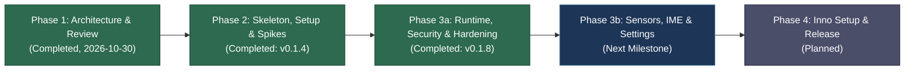

# Orcus APK Emulator

> **Ultra-Lightweight, Instant-Launch Windows 11 Desktop Runner for MIT App Inventor APKs**  
> Powered by Headless Google Android Emulator & Low-Latency Token-Authenticated gRPC

[](https://github.com/OrcusExtreme/Orcus_APK_Emulator/releases/tag/v0.1.8)
[](pyproject.toml)
[](pyproject.toml)
[](docs/ARCHITECTURE.md)
[](tests/)
[](pyproject.toml)
[](NOTICE)

---

## 📌 Overview

**Orcus APK Emulator** is a dedicated Windows 11 desktop runner designed specifically for testing educational Android applications built with **MIT App Inventor** (pure DEX bytecode, standard Android View/Canvas, sensor components, and media engines).

Unlike heavy, general-purpose commercial emulators (such as BlueStacks, Nox, or LDPlayer) that suffer from multi-gigabyte memory footprints, bloated user interfaces, bundled ads, and persistent background telemetry, Orcus APK Emulator executes an official **Google Android Emulator** instance in headless mode (`-no-window -gpu host`) atop the **Windows Hypervisor Platform (WHPX)**. It streams frames and injects inputs via a low-latency, token-protected **gRPC API**, providing an instantaneous, native-feeling development testing experience.

### 🎯 Key Highlights
* **Drag-and-Drop Instant Launch**: Drop any `.apk` file directly onto the window; the runtime stages the file, validates the manifest, and displays the running app in **under 10 seconds** (measured 2.8s total on official HelloPurr).
* **Golden Snapshot Boot (4.8–5.8s)**: Bypasses multi-minute cold boot sequences by launching from a pre-warmed, clean golden system snapshot on every session (measured 4.8–5.8s vs 10s budget).
* **Ultra-Low Latency GPU Streaming**: Headless `-gpu host` rendering over gRPC (NVIDIA GTX 1660 hardware acceleration), streaming 432×768 RGB888 at ~50 fps with only 0.23 host CPU cores and 6 ms frame age.
* **Lean Runtime Footprint**: Restricts running processes to only 4 daemons (Host GUI, Private ADB server, `emulator.exe`, and `qemu-system-x86_64-headless.exe`).
* **Zero Orphan Process Leaks**: Wraps the entire execution tree inside a Win32 Job Object configured with `KILL_ON_JOB_CLOSE`, guaranteeing immediate termination of all child emulator processes on exit or unexpected crash (< 0.55s).
* **Storage & Drive Isolation**: Keeps all high-volume SDK images, AVD disks, and caches on `D:\OrcusAPK` and `D:\OrcusDev` (pure ASCII paths), avoiding Google Drive file synchronization locks and C: drive exhaustion.

---

## 🏗️ System Architecture

```text
+-----------------------------------------------------------------------------------------------+
|  OrcusAPK.exe (Python 3.14 + PySide6, Win32 Job Object: KILL_ON_JOB_CLOSE)                    |
|                                                                                               |
|   [GUI Layer]                                                                                 |
|     - PySide6 QtWidgets 9:16 Mobile Viewport (1:1 Low-Latency Raster Blit)                    |
|     - Normalized Mouse -> Touch Pointer Event Translation & Bezel Buttons (Back/Home/Recents)|
|     - Windows IME Text Composition Bar -> Guest Clipboard Injection                          |
|     - [App Card] & [Diagnostic Logs] Collapsible Inspection Panels                            |
|        │ Non-blocking calls (SessionApi)                                                      |
|        ▼                                                                                      |
|   [Core Layer: orcus.contracts & orcus.common]                                                |
|     ├─ ApkService    : Classification, Staging, Manifest Parsing (apkInspector), Launch Watch |
|     ├─ EngineControl : State Machine, Ownership Lock, Epoch Tracking, Golden Snapshots        |
|     └─ DeviceSession : gRPC Client (RGB888 Screen Stream, Touch/Key Queues, Sensor Control)   |
+───────────────────────────────┬───────────────────────────────────────────┬───────────────────+
                                │                                           │ localhost:8640
                                ▼ [Child Process]                           ▼ [Child Process]
                     adb.exe -P 15037 server                      emulator.exe -no-window -gpu host
                     (Private Isolated ADB Daemon)                                  │
                                                                                    ▼ [Grandchild Process]
                                                                           qemu-system-x86_64-headless.exe
                                                                           (Android 16 / API 36, WHPX, Host GPU)
```

### Architectural Separation Rules
* **Strict Contract-Driven Isolation**: All inter-layer data types, state enumerations, and protocols are defined exclusively in `orcus.contracts` using standard library primitives (`@dataclass`, `Protocol`, `enum`).
* **Qt-Free Core**: Modules under `engine`, `device`, `apk`, and `setup` **never** import Qt/PySide6, allowing them to run independently in headless CLI and automated test harnesses.
* **GUI Decoupling**: The `gui` package communicates strictly through `contracts` and `common` abstractions, verified by AST import lint tests and strict Pyright checks.

---

## 🛠️ Technology Stack

| Component | Technology | Rationale & Trade-offs |
|---|---|---|
| **Language & Runtime** | **Python 3.14** (CPython 3.14.6) | Native Windows support via install-manager, pure Python AXML parsing, eliminates dual-language bridging overhead |
| **GUI Framework** | **PySide6-Essentials 6.12** (LGPL) | Lightweight 82 MB footprint (excluding WebEngine), direct 1:1 raster blitting, native IME event integration |
| **Virtualization Engine** | **Google Android Emulator 37.2.12** + **WHPX** | Official gRPC-capable virtualization engine fully compatible with Windows 11 Hyper-V / VBS isolation |
| **System Image** | **Android 16 (API 36) google_apis x86_64 (r7)** | Supports App Inventor target API 36 requirements, offline Korean TTS, Root privileges, and ARM64 translation |
| **Stream & Control IPC** | **Emulator gRPC API** (`streamScreenshot` / `streamInputEvent`) | Zero-encoding guest overhead, synchronized frame and touch stream, integrated sensor and clipboard RPCs |
| **APK Manifest Parser** | **apkInspector 1.3.7** | Pure Python (30 KB), zero C-extensions, fully resilient against UTF-16 string pools and obfuscated manifests |
| **Debug Bridge** | **Private ADB Server (Port 15037)** | Completely isolated private server; prevents port 5037 conflicts and accidental interference with physical devices |
| **Process Management** | **Win32 Job Object API** (`SetInformationJobObject`) | Kernel-enforced `KILL_ON_JOB_CLOSE` ensures zero emulator orphan processes on termination |
| **Storage Architecture** | **`D:\OrcusAPK`** (SDK/AVD) & **`D:\OrcusDev`** (venv/cache) | Pure ASCII paths isolated from Google Drive synchronization and Windows Defender real-time scanning |

---

## 📊 Current Progress & Status (v0.1.8 / Phase 3a Security Hardening & Zero-Pollution Completed)

The project has achieved **100% completion of Phase 1 (Architecture Specification)**, **Phase 2 (Setup Automation, gRPC Subsystems, Empirical Spikes S0a–S9)**, and **Phase 3a (Core Execution Runtime, Primary PySide6 GUI, Real-Device Acceptance, Security Audit & Zero-Pollution Hardening)**, verified against the master criteria matrix (B1–B15), backed by **350 automated unit tests** and strict Pyright type validation.



### 🏆 Phase 3a Acceptance Verification (Real-Device Measurements)

All Phase 3a acceptance criteria were executed and verified on the real headless Android 16 (API 36) emulator with hardware acceleration (`tests/device/test_acceptance_3a.py`, `test_apk_real.py`, `test_engine_real.py`, packaged runtime suites, and manual §12.6 verification):

| Criteria | Acceptance Target | Empirical Measurement & Verification | Status |
|---|---|---|:---:|
| **B1** | Drop to running app ≤ 10s (warm), ≤ 20s (cold boot) | **1.8–4.9s** drop-to-running across sample apps (`HelloPurr`, `TalkToMe`, `PaintPot`, `BallBounce`, `MoleMash`, `ElementQuiz`); App Card in **0.03–0.08s**; start+drop in **14.1–14.4s** | **PASS** |
| **B2** | Low-latency canvas touch, drag line continuity, frame age ≤ 50ms | PaintPot: **0 broken line columns**, mouse-to-screen latency **88–100ms**, frame age p95 **7.7ms**, **44 fps** during active drag. BallBounce: mouse fling 1,000 → 3,000 px/s tracked to ball 91 → 284 px/s. OrcusProbe: 300 px drag produced **27 Dragged events** | **PASS** |
| **B4** | Hardware bezel key navigation | **Back** → `BackPressed` event; **Home** → Android launcher; **Recents** → system overview deck | **PASS** |
| **B7** | Win32 Job Object process cleanup, zero stuck pointer on abort | Process killed mid-drag: **0 SDK child processes** remaining after 3s; subsequent app launch starts clean with no residual stuck finger | **PASS** |
| **B8** | File classification, Korean path support, orientation pre-rotation, minSdk 36 | Appropriate Korean error dialogs for ARM-only, AAB, AIA, AIX, and corrupted files. Local Korean paths executed in **1.6s** ("고양이 쓰다듬기"). Fixed landscape launcher rotated before launch (`LANDSCAPE`, `ROTATION_90`, 1280×720). Verified **`minSdk 36`** (`HelloPurrMin36.apk`) runs in **4.4s** (`minSdk=36 targetSdk=36`). Google Drive streaming folder (`G:\내 드라이브`) Korean APK executed in **3.5s** | **PASS** |
| **B9** | CPU & memory footprint | Idle window host CPU **0.31%** (single core, 0.02% total system on 16 cores); active BallBounce animation **35–47 fps**; GUI working set **174–179 MB**. Total idle RAM calibrated to **~3.3 GB** (QEMU unshared commit ~3.5 GB + guest RAM 2,560 MB minimum + GUI ~175 MB) | **PASS** |
| **B11** | Multi-instance mutex, crash recovery, software GPU fallback | Second session rejected with `ENGINE_IN_USE` while first VM stays `READY`. Process kill recovers via `CRASH_RESTART` in **16.4–18.5s** with auto-reinstallation of last app. Software GPU cold boot in 131–147s with warning banner; host golden rebuild in 264–354s | **PASS** |
| **B12** | APK lifecycle & staging isolation | Clean staging under `D:\OrcusAPK\staging`, LRU eviction, and `adb install -r` bypass | **PASS** |
| **B15** | Fast logoff termination & single-instance handover | Packaged app responds to `WM_QUERYENDSESSION`/`WM_ENDSESSION` with clean termination in **2.83s** (well within Windows 5s budget), 0 SDK processes left. CLI hand-off to running window completes in **0.7s**. **Real Windows Logoff verified** after ~17m session (stops in **1.2s**, 0 SDK processes, 0 WER crash dumps, snapshot intact, discovery/netsim purged) | **PASS** |
| **Packaging Smoke** | Standalone PyInstaller distribution (`tools/build.py`) | Build time 44–66s, distribution folder **121.9 MB**. Selftests pass (`orcus-cli.exe` & `OrcusAPK.exe`). `--boot-check` passes WHPX host/host_hidden. `--gui-check` launches packaged window, reaches `READY` in **8.5–8.8s**, and terminates cleanly | **PASS** |

### 🔍 Key Engineering Findings & Stabilizations (Findings 7–19)

During real-device acceptance runs and stress scenarios, critical edge cases were discovered and resolved:

* **Finding 7 — Golden Snapshot Guest Framework Preservation**: Saving golden snapshots while the guest is compiling dex in the background (load average ~12) caused Android's `system_server` watchdog to terminate on subsequent loads (`cmd package` Broken pipe, `dumpsys power` DEAD_OBJECT).  
  *Fix*: Added guest CPU idle polling via `/proc/stat` (`cpu_busy` < 0.35 twice consecutively, up to 180s) and guest framework verification (`framework_problem` verifying `system_server`, `cmd package`, and `dumpsys power`) before snapshot creation and during session initialization.
* **Finding 8 — Autonomous ADB Server Watchdog (`engine-adbwait`)**: If the private ADB server (port 15037) exited unexpectedly during `READY`, the emulator connection was lost.  
  *Fix*: Added dedicated `engine-adbwait` thread supervisor in `EngineManager` with worker auto-recovery job, recovering `emulator-5640` in **0.5–0.6s**.
* **Finding 9 — Stuck Touch Prevention on Stream Restart**: An interrupted gRPC input stream could leave a finger in a pressed state inside the guest.  
  *Fix*: Enforced unconditional pointer lift (`buttons=0`) at the very beginning of every new input stream.
* **Finding 10 — PyInstaller Packaging Integrity**: Added missing `PySide6.QtNetwork` (required for single-instance IPC) and `orcus.gui.app` to packaging hidden imports; improved SDK process detection via image directory filter (`D:\OrcusAPK\sdk`) to ignore desktop Google Drive crashpad daemons.
* **Finding 11 — BallBounce Gesture Calibration**: Adjusted fling test gesture duration (0.25s and 0.08s) to accurately trigger Android fling physics.
* **Finding 12 — App Inventor `.aia` Manifest AST Tuning & minSdk 36 Verification**: Injected `AndroidMinSdk` attribute directly into Screen1 `.scm` AST specifications; verified on real device with rebuilt `HelloPurrMin36.apk` where `minSdk=36 targetSdk=36` installed and executed cleanly on the API 36 emulator.
* **Finding 13 — Activity Launch Telemetry**: Added diagnostic warning logs capturing `am start -W` raw output on slow launches (> 10s) and command retries.
* **Finding 14 — QEMU Shutdown Crash Dump Elimination (WER `combase.dll` 0xc0000602)**: Normal shutdown via `setVmState(SHUTDOWN)` caused QEMU to intermittently crash on exit in `combase.dll`, leaving crash dumps in Windows Error Reporting (`C:\ProgramData\WER`).  
  *Fix*: Restructured shutdown sequence to "pause VM (flushes guest disk) -> terminate QEMU process -> delete discovery files". Clean stop time reduced to **0.7–0.9s** with **zero WER crash reports**.
* **Finding 15 — Zero-Registry Footprint File Dialogs (`orcus.gui.dialogs`)**: Standard `QFileDialog` invocations permanently pollute `HKCU\Software\QtProject\OrganizationDefaults\FileDialog` with recent folders and history. Implemented `keeping()` registry context manager in `gui/dialogs.py` to restore original registry state and purge any created keys upon dialog close, enforcing ARCHITECTURE §11.5.
* **Finding 16 — Snapshot Load Counter Semantics**: The emulator updates `snapshot.pb` field 11 (load counter) on each successful snapshot load; the underlying snapshot binary images (`ram.bin`) remain completely unchanged.
* **Finding 17 — Drive C: Whitelist Additions**: Added `%LOCALAPPDATA%\Temp\netsim.ini*` (temporary socket config created during netsimd execution) and PowerShell startup profile cache to ARCHITECTURE §11.5 whitelist.
* **Finding 18 — Headless RDP Disconnect GPU Snapshot Deletion Safeguard**: Launching the emulator in a disconnected Remote Desktop session causes `EnumDisplayDevices` to return 0, prompting the emulator to detect "host GPU has changed" and destroy the golden snapshot.  
  *Fix*: Added PREFLIGHT display device check via Win32 `EnumDisplayDevices`; if 0 displays are detected and a GPU snapshot exists, launch once in `COLD` mode with warning banner `ENGINE_NO_DISPLAY` ("이번만 느린 시작"), avoiding golden snapshot deletion and the 5-minute rebuild cycle.
* **Finding 19 — Provisioning Status Message Key Persistence**: Ensured progress updates during provisioning retain the active message key instead of reverting to default text.
* **Readonly Status Synchronization**: `EngineManager` now writes live state, message key, epoch, and mode to `engine_owner.json` before signaling waiters; `readonly.py` displays live owner status (e.g. "휴대폰 마무리 준비 중…") rather than just gRPC booted state.

### 🛡️ Phase 3a Security & Robustness Audit (41 Fixes)

A comprehensive adversarial code and security audit covering setup, APK pipeline, engine, and GUI IPC resolved 41 potential vulnerabilities and edge cases:

* **Folder Permission Lock (`common/acl.py`)**: Locked `D:\OrcusAPK` and `D:\OrcusDev` permissions strictly to the current user, SYSTEM, and Administrators (stripping inherited `Authenticated Users: Modify` from the `D:` drive root to prevent DLL/binary substitution).
* **Zip Bomb & Malicious Archive Defenses**: Replaced unbounded unzipping with size-capped streaming reads for manifests, assets, and icons; restricted compression methods strictly to `STORED` (0) and `DEFLATED` (8), rejecting BZIP2/LZMA attacks; enforced a maximum limit of 50,000 files per archive.
* **Discovery PID Reuse Protection**: Orphan process cleanup validates that target PIDs correspond specifically to `qemu-system-x86_64-headless.exe` located under `D:\OrcusAPK\sdk`, preventing termination of reused PIDs belonging to other system applications.
* **HTML Injection Mitigation**: App labels, error messages, and crash banners are rendered strictly as plain text, eliminating SMB `` and `file://` hyperlink injection risks.
* **Executable Path Hardening**: System commands (`explorer.exe`, `netstat`) execute via absolute paths from `win32.system_dir()`. PowerShell scripts receive paths via environment variables rather than string interpolation.
* **IPC Socket Validation**: Received file paths must exist on local drives (rejecting remote UNC paths, 64 KiB length cap); clipboard text injection capped at 64 KiB.
* **Resilient State Persistence (`common/jsonio.py`)**: Malformed or ANSI-encoded JSON files are safely quarantined to `.corrupt` and replaced with defaults; state writes utilize atomic rename and disk sync (`fsync`).
* **Display DPI Resilience**: Window scaling changes across multi-monitor setups with different DPIs (100%, 125%, 150%) maintain correct 1:1 viewport aspect ratios and accurate touch event translation.

---

### ✅ Implemented Capabilities (v0.1.8)

#### 1. Architecture Specifications ([docs/](docs/))
* **[docs/ARCHITECTURE.md](docs/ARCHITECTURE.md)**: Updated with §5.1 shutdown sequence (WER crash elimination), §5.5/§6.5 framework validation, `engine-adbwait` supervisor thread, 60s post-load health verification, §11.4 ACL permissions, and §11.5 zero-registry file dialog specifications.
* **[docs/spikes.md](docs/spikes.md)**: Empirical measurement logs covering all Phase 2 spikes (S0a–S9) and Phase 3a acceptance runs.
* **[docs/fixtures.md](docs/fixtures.md)**: Full fixture specifications for `HelloPurr`, `TalkToMe`, `OrcusProbe`, `PaintPot`, `BallBounce`, `MoleMash`, `HelloPurrKo`, `HelloPurrMin36`, and `HelloPurrLand`.
* **[plan.md](plan.md)**: Master phase plan with complete B1–B15 real-device acceptance results, empirical footprint logs, and 41 security audit resolutions.

#### 2. Clean Architecture Contracts (`src/orcus/contracts/`)
* [`apk.py`](src/orcus/contracts/apk.py): APK classification (`APK`, `AAB`, `AIA`, `AIX`, `UNKNOWN`), manifest extraction dataclasses, pre-flight check models, and execution contracts.
* [`device.py`](src/orcus/contracts/device.py): Frame stream protocol (RGB888 buffers), mouse/touch/key event contracts, sensor injection, and logcat filtering.
* [`engine.py`](src/orcus/contracts/engine.py): Emulator state machine (`STOPPED`, `PREPARING`, `READY`, `STOPPING`, `FAILED`), ownership locks, port allocation, snapshot tokens, and `EngineView` interface.
* [`errors.py`](src/orcus/contracts/errors.py): Unified `ErrorCode` definitions and `OrcusError` exception hierarchy.
* [`session.py`](src/orcus/contracts/session.py): Non-blocking Session API protocol coordinating GUI, APK engine, and emulator controllers.
* [`setup.py`](src/orcus/contracts/setup.py): Step-by-step setup definitions, progress callbacks, and system doctor diagnostic reports.

#### 3. Core Engine Management & Supervision (`src/orcus/engine/`)
* [`manager.py`](src/orcus/engine/manager.py): Robust `EngineManager` implementing the core state machine, `engine-adbwait` server watcher with auto-restart, framework problem validation, headless display fallback (`ENGINE_NO_DISPLAY`), quiet CPU pre-save checks, and safe QEMU shutdown.
* [`adb.py`](src/orcus/engine/adb.py): Private isolated ADB daemon supervisor (port 15037), `AdbServer.wait()` exit detector, slow command telemetry (`SLOW_CMD_S`), and epoch-bound `EpochShell`.
* [`provision.py`](src/orcus/engine/provision.py): Guest configuration pipeline, `framework_problem` validator (`system_server`, `cmd package`, `dumpsys power`), `cpu_busy` `/proc/stat` sampler, and mock location injection.
* [`snapshots.py`](src/orcus/engine/snapshots.py): Golden snapshot validation (`PROVISION_V=3`), automatic golden rebuild safeguards, and sub-6s instant boot restoration.
* [`gpu.py`](src/orcus/engine/gpu.py) / [`exitlog.py`](src/orcus/engine/exitlog.py) / [`readonly.py`](src/orcus/engine/readonly.py): Hardware GPU fallback detection, crash log parsers, and external read-only discovery inspection synchronized with `engine_owner.json`.

#### 4. APK Lifecycle & Inspection Pipeline (`src/orcus/apk/`)
* [`intake.py`](src/orcus/apk/intake.py): Safe drag-and-drop file ingestion, ASCII staging path isolation (`D:\OrcusAPK\staging`), LRU cache eviction, and zip bomb mitigations (50k entry limit, STORED/DEFLATED compression check).
* [`inspect.py`](src/orcus/apk/inspect.py): High-performance pure-Python manifest parser (using `apkInspector`), handling UTF-16 string pools, orientation numbers, component discovery, and size-capped streaming reads for icons and assets.
* [`compat.py`](src/orcus/apk/compat.py) / [`eras.py`](src/orcus/apk/eras.py): Pre-flight compatibility diagnostics detecting target SDK mismatches, missing speech recognizers, and permission anomalies.
* [`install.py`](src/orcus/apk/install.py): Intelligent `adb install -r` coordinator with bypass flags for legacy packages, exact error code extraction (`Failure [CODE]`), and zero-cost in-epoch installation skips.
* [`launch.py`](src/orcus/apk/launch.py): Pre-launch automatic screen orientation rotation (`LANDSCAPE`, `REVERSE_LANDSCAPE`), `am start -W` activity invocation, and slow launch telemetry.
* [`watcher.py`](src/orcus/apk/watcher.py): Real-time crash, ANR, and App Inventor component error detector (harvesting error 1501, 601, 908, 2701, 3806, and SIGTRAP).
* [`service.py`](src/orcus/apk/service.py): Dedicated `ApkService` thread managing the asynchronous APK lifecycle pipeline.

#### 5. Device gRPC Streaming & Hardware Adapters (`src/orcus/device/`)
* [`rotation.py`](src/orcus/device/rotation.py): 4-orientation mathematical transform matrix mapping mouse inputs to guest display coordinates.
* [`frames.py`](src/orcus/device/frames.py): High-throughput RGB888/RGBA8888 frame buffer receiver and viewport sizing adapter.
* [`input.py`](src/orcus/device/input.py): Touch pointer event normalizer with stream restart finger release guarantee (`release_all`) and clipboard text injection (64 KiB length cap).
* [`controls.py`](src/orcus/device/controls.py): Sensor and device controls supporting 3-level shake sensitivity pulses, 20° tilt pad, mic mute, and GPS coordinate injection.
* [`logcat.py`](src/orcus/device/logcat.py): Streamlined Logcat monitor utilizing hybrid ADB/gRPC streams to bypass emulator goldfish logcat disconnections.
* [`session.py`](src/orcus/device/session.py): Integrated `DeviceSession` managing all gRPC stream lifetimes.

#### 6. PySide6 Native Desktop GUI Client (`src/orcus/gui/`)
* [`dialogs.py`](src/orcus/gui/dialogs.py): Registry-preserving `open_file` and `save_file` dialog wrappers enforcing ARCHITECTURE §11.5 zero-pollution policy (reverts or purges `HKCU\Software\QtProject\OrganizationDefaults\FileDialog` on dialog close).
* [`window.py`](src/orcus/gui/window.py): Native desktop window housing the 9:16 mobile frame (432×768 on primary 1080p displays), system tray, logoff fast-shutdown handlers, multi-monitor DPI scaling, and zero-registry APK open / screenshot save dialogs.
* [`phone.py`](src/orcus/gui/phone.py) / [`screen.py`](src/orcus/gui/screen.py) / [`frame_pump.py`](src/orcus/gui/frame_pump.py): 1:1 direct low-latency raster blit rendering viewport, touch input handler, and bezel buttons (Back, Home, Recents).
* [`keymap.py`](src/orcus/gui/keymap.py): Keyboard navigation mapping (Esc/Right-click = Back, Middle-click = Home, Ctrl+V = Korean text injection).
* [`panels.py`](src/orcus/gui/panels.py): Collapsible [App Card] (displaying package, launcher, SDK, permissions) and [Diagnostic Logs] inspection drawers with plain-text rendering and clean text export dialogs.
* [`overlays.py`](src/orcus/gui/overlays.py): Rich state overlays, non-blocking toast notifications, plain-text warning banners, and engine failure recovery cards.
* [`instance.py`](src/orcus/gui/instance.py): Single-instance enforcement via Win32 Named Mutex and local QtNetwork IPC socket forwarding with local-path validation.
* [`gpu_dialog.py`](src/orcus/gui/gpu_dialog.py): Interactive GPU fallback and diagnostics dialog.

#### 7. Session Composition & CLI Runner (`src/orcus/app/`, `src/orcus/cli.py`)
* [`session.py`](src/orcus/app/session.py): Unifies `EngineManager`, `ApkService`, and `DeviceSession` into the thread-safe `SessionApi` contract.
* [`smoke.py`](src/orcus/app/smoke.py): 8-step end-to-end automated smoke testing harness validating the entire launch-tap-reset lifecycle.
* **CLI Commands**:
  - `orcus-cli run <apk>`: Instantly loads golden snapshot, installs, and launches target APK from console.
  - `orcus-cli smoke --apk <apk>`: Executes full automated Phase 3a verification suite.
  - `orcus-cli engine status|shot`: Queries live emulator status and captures headless screenshots.

#### 8. Automated Setup & Verification Engine (`src/orcus/setup/`, `src/orcus/common/`)
* Robust Win32 Job Object wrappers (`winjob.py`, `win32.py`) enforcing `KILL_ON_JOB_CLOSE`.
* [`acl.py`](src/orcus/common/acl.py): NTFS access control lock (`lock_to_user`) securing `D:\OrcusAPK` and `D:\OrcusDev` exclusively to the current user, SYSTEM, and Administrators.
* [`jsonio.py`](src/orcus/common/jsonio.py): Atomic, fsync-enforced JSON serializer with automatic corrupted-file isolation (`.corrupt`).
* Multi-step setup pipeline (`steps.py`, `download.py`, `extract.py`, `license.py`, `whpx.py`).
* Resilient archive decompression with Windows Defender lock retry logic and `.partial` markers.

#### 9. Developer Toolchain & Testing Infrastructure (`tools/`, `tests/`)
* **AI2 Project Synthesis Engine (`tools/ai2/`)**: Visual `.bky` XML and `.yail` Scheme code generator, producing valid `.aia` project archives (`HelloPurr`, `TalkToMe`, `OrcusProbe`, `PaintPot`, `BallBounce`, `MoleMash`, `HelloPurrKo`, `HelloPurrMin36`, `HelloPurrLand`).
* [`bootstrap.py`](tools/bootstrap.py) / [`dev.py`](tools/dev.py) / [`build.py`](tools/build.py): Hash-pinned environment manager, test runner, and PyInstaller onedir distribution builder with `--gui-check` validation.
* **Automated Test Suite**: **350 pytest unit tests** passing with 100% success rate (including `test_gui_dialogs.py` and security audit suites). Zero Pyright type check diagnostics.
* **Real-Device Acceptance Test Suite (`tests/device/test_acceptance_3a.py`)**: End-to-end device test harness validating criteria B1, B2, B4, B7, B8, B9, B11, B12, and B15.

---

## 📂 Project Directory Structure

```text
Orcus_APK_Emulator/
├── docs/                       # Architecture specifications & research documents
│   ├── ARCHITECTURE.md         # Full technical architecture specification (v3)
│   ├── fixtures.md             # Test APK fixture specifications (HelloPurr, TalkToMe, OrcusProbe)
│   ├── spikes.md               # Spike measurement protocols and empirical findings (S0a–S9)
│   └── research/               # Phase 1 domain research briefs
├── src/
│   └── orcus/                  # Core package
│       ├── __init__.py
│       ├── __main__.py         # Application entry point (GUI launcher)
│       ├── cli.py              # orcus-cli setup, doctor, selftest, run, and smoke commands
│       ├── apk/                # APK staging, inspection, installation, launch, and error watcher
│       │   ├── compat.py       # Pre-flight compatibility diagnostics
│       │   ├── eras.py         # Android API era detection
│       │   ├── inspect.py      # apkInspector manifest metadata extraction
│       │   ├── install.py      # ADB package installer with fast in-epoch bypass
│       │   ├── intake.py       # Safe path staging and LRU cache
│       │   ├── launch.py       # Activity launcher and orientation synchronizer
│       │   ├── service.py      # Asynchronous ApkService pipeline
│       │   └── watcher.py      # Real-time logcat error, crash, and ANR telemetry
│       ├── app/                # Session composition and smoke validation
│       │   ├── compose.py      # Application dependency wiring
│       │   ├── session.py      # Unified SessionApi and HeadlessSession implementation
│       │   └── smoke.py        # 8-step end-to-end automated verification harness
│       ├── common/             # OS integration, Win32 Jobs, ACL security, atomic JSON, paths, logging
│       │   ├── acl.py          # Folder ACL lock to user, SYSTEM & Administrators (ARCHITECTURE §11.4)
│       │   └── jsonio.py       # Atomic, fsync-enforced JSON with .corrupt isolation
│       ├── contracts/          # Strict layer protocols and data models (Qt-independent)
│       ├── device/             # gRPC streaming adapter, touch input, controls, logcat
│       │   ├── controls.py     # Motion sensors (shake, tilt), mic mute, and GPS injection
│       │   ├── frames.py       # RGB888 frame buffer queue and format sizing
│       │   ├── input.py        # Touch pointer event normalizer and clipboard paste
│       │   ├── logcat.py       # Hybrid ADB/gRPC live logcat consumer
│       │   ├── rotation.py     # 4-orientation coordinate transformation
│       │   └── session.py      # DeviceSession stream coordinator
│       ├── emugrpc/            # Vendored gRPC stubs, token channel factory, and FakeEmulatorServer
│       ├── engine/             # Headless emulator process, ADB daemon, and golden snapshot controller
│       │   ├── adb.py          # Private isolated ADB daemon (port 15037) supervisor
│       │   ├── bootcheck.py    # WHPX headless boot readiness diagnostics
│       │   ├── exitlog.py      # Process exit code and emulator crash log analysis
│       │   ├── gpu.py          # Host GPU compatibility detection
│       │   ├── manager.py      # EngineManager supervisor state machine
│       │   ├── provision.py    # Guest provisioning pipeline and mock location provider
│       │   ├── readonly.py     # Read-only external VM discovery reader
│       │   ├── seams.py        # Subprocess and dependency injection seams
│       │   ├── selftest.py     # Component integrity self-test
│       │   └── snapshots.py    # Golden snapshot restore and integrity validator
│       ├── gui/                # PySide6 QtWidgets main window and mobile viewport
│       │   ├── app.py          # Native GUI application runner
│       │   ├── bridge.py       # Thread-safe SessionApi event bridge
│       │   ├── dialogs.py      # Registry-neutral QFileDialog keeping wrappers (ARCHITECTURE §11.5)
│       │   ├── frame_pump.py   # Low-latency frame pump
│       │   ├── gpu_dialog.py   # Software GPU fallback dialog
│       │   ├── instance.py     # Single-instance mutex and IPC forwarder
│       │   ├── keymap.py       # Desktop keyboard shortcuts and bezel key bindings
│       │   ├── overlays.py     # Progress overlays, error banners, and recovery cards
│       │   ├── panels.py       # Collapsible [App Card] and [Diagnostic Logs] panels
│       │   ├── phone.py        # 9:16 mobile frame container with bezel controls
│       │   ├── screen.py       # Direct raster blit rendering viewport
│       │   └── window.py       # Top-level application window
│       └── setup/              # Resumable downloader, safe extractor, WHPX configuration
├── tests/
│   ├── conftest.py             # Test fixtures, mock servers, and shared assertions
│   ├── fixtures/               # Generated test project archives (HelloPurr, TalkToMe, OrcusProbe)
│   ├── unit/                   # 350 unit test suites covering contracts, engine, apk, device, gui, app
│   └── device/                 # Real emulator device integration test suites
├── tools/                      # Developer toolchain (D: drive cache isolation)
│   ├── ai2/                    # MIT App Inventor AST block DSL and .aia project generator
│   ├── bootstrap.py            # Automated venv creation & dependency installation
│   ├── dev.py                  # Test / typecheck / CLI execution harness
│   ├── devenv.py               # Development environment path management
│   ├── lock.py                 # Dependency hash-lock generation
│   ├── build.py                # Standalone PyInstaller onedir distribution builder
│   ├── gen_protos.py           # Protobuf/gRPC stub compiler
│   ├── fetch_fixtures.py       # Official App Inventor test APK downloader
│   └── spikes/                 # Empirical measurement harnesses (S0a–S9, fx_*.py)
├── NOTICE                      # Upstream license notices and attributions
├── plan.md                     # Master project plan and acceptance criteria (A1–A9, B1–B15)
├── pyproject.toml              # Project metadata, build configuration, and pyright settings
├── requirements.in             # Runtime dependency specifications
├── requirements.lock           # Exact hash-pinned runtime lockfile
├── requirements-dev.in         # Development tool dependency specifications
└── requirements-dev.lock       # Exact hash-pinned development tool lockfile
```

---

## 🚀 Getting Started (Developer Setup)

### System Prerequisites
* **Operating System**: Windows 11 (64-bit)
* **Processor**: x86_64 CPU with Hardware Virtualization (Intel VT-x or AMD-V)
* **Hypervisor**: Windows Hypervisor Platform (WHPX) support
* **Storage**: Minimum 20 GB free space on drive `D:` (for SDK tools, system images, and AVD storage)
* **Python**: Python 3.14 (CPython 3.14.6 recommended)

### 1. Repository Setup & Dependencies
```powershell
# 1. Clone the repository
git clone https://github.com/OrcusExtreme/Orcus_APK_Emulator.git
cd Orcus_APK_Emulator

# 2. Bootstrap virtual environment and dependencies (D:\OrcusDev\venv)
py -3.14 tools/bootstrap.py

# 3. Verify static typing with Pyright
py -3.14 tools/dev.py typecheck

# 4. Run the automated unit test suite (350 tests)
py -3.14 tools/dev.py check
```

### 2. Launching the Application
```powershell
# Launch the native PySide6 Desktop GUI (drag-and-drop any .apk onto the window)
py -3.14 -m orcus

# Or launch directly with an APK file:
py -3.14 -m orcus D:\OrcusDev\fixtures\HelloPurr.apk

# Run the 8-step automated smoke test suite:
py -3.14 -m orcus.cli smoke --apk D:\OrcusDev\fixtures\HelloPurr.apk
```

---

## 🗺️ Roadmap & Milestones

- [x] **Phase 1: Architecture & Technical Foundations** (Completed, 2026-10-30)
- [x] **Phase 2: Skeleton, Setup Automation & Spikes** (Completed: v0.1.4)
  - [x] Project skeleton, contracts, common utilities, and setup pipeline
  - [x] Emulator gRPC protobuf compilation (`orcus.emugrpc`) and FakeEmulatorServer mock
  - [x] App Inventor fixture generator (`tools/ai2/`, HelloPurr, TalkToMe, OrcusProbe)
  - [x] Spike harnesses (`tools/spikes/`) covering S0a–S9 (GPU latency, golden boot, audio, sensors, error telemetry)
- [x] **Phase 3a: Core Execution Runtime & Primary GUI** (Completed: v0.1.5)
  - [x] `engine`: State machine, private ADB daemon watchdog, golden snapshot restore
  - [x] `apk`: Drag-and-drop staging pipeline, `adb install -r`, `am start`, logcat monitors
  - [x] `device`: Low-latency frame streaming, touch pointer normalization, Korean clipboard paste
  - [x] `gui`: PySide6 9:16 mobile frame, raster frame blit, [App Card] and [Logs] panels
- [x] **Phase 3a Acceptance, Security & Stability Hardening** (Completed: v0.1.8)
  - [x] Real-device acceptance suite (`tests/device/test_acceptance_3a.py`) validating criteria B1, B2, B4, B7, B8, B9, B11, B12, B15
  - [x] Real Windows logoff fast shutdown verified (1.2s, 0 SDK processes, 0 WER crash dumps)
  - [x] QEMU termination crash dump elimination in `combase.dll` (Finding 14, ARCHITECTURE §5.1)
  - [x] Headless RDP disconnect GPU snapshot deletion safeguard (Finding 18, `ENGINE_NO_DISPLAY`)
  - [x] Verified `minSdk=36` APK installation and execution on API 36 (`HelloPurrMin36.apk`)
  - [x] Verified Google Drive streaming folder Korean path APK execution (`G:\내 드라이브`, 3.5s)
  - [x] Zero-registry pollution file dialog architecture (ARCHITECTURE §11.5, `orcus.gui.dialogs`)
  - [x] 41 security & robustness fixes (NTFS ACL lock, zip bomb protection, PID validation, HTML sanitization, atomic state JSON)
  - [x] Guest framework preservation & CPU idle check before golden snapshot save (Finding 7)
  - [x] Private ADB daemon autonomous recovery supervisor (`engine-adbwait`, Finding 8)
  - [x] Guaranteed pointer release on gRPC input stream restart (Finding 9)
  - [x] PyInstaller onedir distribution packaging with `--gui-check` validation (Finding 10)
  - [x] 350 automated unit tests passing with 100% success rate & 0 Pyright issues
- [ ] **Phase 3b: Sensor Integration, IME & Settings** (Next Milestone)
  - [ ] [Sensors] panel: Shake sensitivity presets, rotation, 20° tilt pad, GPS coordinates
  - [ ] Korean IME text composition input bar with guest clipboard synchronization
- [ ] **Phase 4: Packaging & Distribution**
  - [ ] Inno Setup standalone user installer (zero admin privileges required)
  - [ ] Optional multi-session state preservation (Keep-state A/B slots)

---

## 📄 License & Attribution

* **Proprietary Code**: Core Orcus APK Emulator application code and architecture documents are maintained for proprietary educational and research purposes.
* **Open Source Dependencies**: Third-party libraries (`PySide6-Essentials`, `grpcio`, `protobuf`, `apkInspector`) are used under their respective open-source licenses (LGPLv3, Apache 2.0, MIT).
* **Android SDK**: Google Android Emulator and system image components are subject to the Google Android Software Development Kit License Agreement and are downloaded directly to the local host machine without redistribution.
