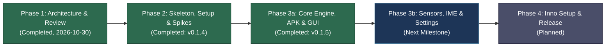

# Orcus APK Emulator

> **Ultra-Lightweight, Instant-Launch Windows 11 Desktop Runner for MIT App Inventor APKs**  
> Powered by Headless Google Android Emulator & Low-Latency Token-Authenticated gRPC

[](https://github.com/OrcusExtreme/Orcus_APK_Emulator/releases/tag/v0.1.5)
[](pyproject.toml)
[](pyproject.toml)
[](docs/ARCHITECTURE.md)
[](tests/)
[](pyproject.toml)
[](NOTICE)

---

## 📌 Overview

**Orcus APK Emulator** is a dedicated Windows 11 desktop runner designed specifically for testing educational Android applications built with **MIT App Inventor** (pure DEX bytecode, standard Android View/Canvas, sensor components, and media engines).

Unlike heavy, general-purpose commercial emulators (such as BlueStacks, Nox, or LDPlayer) that suffer from multi-gigabyte memory footprints, bloated user interfaces, bundled ads, and persistent background telemetry, Orcus APK Emulator executes an official **Google Android Emulator** instance in headless mode (`-no-window -gpu host`) atop the **Windows Hypervisor Platform (WHPX)**. It streams frames and injects inputs via a low-latency, token-protected **gRPC API**, providing an instantaneous, native-feeling development testing experience.

### 🎯 Key Highlights
* **Drag-and-Drop Instant Launch**: Drop any `.apk` file directly onto the window; the runtime stages the file, validates the manifest, and displays the running app in **under 10 seconds** (measured 2.8s total on official HelloPurr).
* **Golden Snapshot Boot (4.8–5.8s)**: Bypasses multi-minute cold boot sequences by launching from a pre-warmed, clean golden system snapshot on every session (measured 4.8–5.8s vs 10s budget).
* **Ultra-Low Latency GPU Streaming**: Headless `-gpu host` rendering over gRPC (NVIDIA GTX 1660 hardware acceleration), streaming 432×768 RGB888 at ~50 fps with only 0.23 host CPU cores and 6 ms frame age.
* **Lean Runtime Footprint**: Restricts running processes to only 4 daemons (Host GUI, Private ADB server, `emulator.exe`, and `qemu-system-x86_64-headless.exe`).
* **Zero Orphan Process Leaks**: Wraps the entire execution tree inside a Win32 Job Object configured with `KILL_ON_JOB_CLOSE`, guaranteeing immediate termination of all child emulator processes on exit or unexpected crash (< 0.55s).
* **Storage & Drive Isolation**: Keeps all high-volume SDK images, AVD disks, and caches on `D:\OrcusAPK` and `D:\OrcusDev` (pure ASCII paths), avoiding Google Drive file synchronization locks and C: drive exhaustion.

---

## 🏗️ System Architecture

```text
+-----------------------------------------------------------------------------------------------+
|  OrcusAPK.exe (Python 3.14 + PySide6, Win32 Job Object: KILL_ON_JOB_CLOSE)                    |
|                                                                                               |
|   [GUI Layer]                                                                                 |
|     - PySide6 QtWidgets 9:16 Mobile Viewport (1:1 Low-Latency Raster Blit)                    |
|     - Normalized Mouse -> Touch Pointer Event Translation & Bezel Buttons (Back/Home/Recents)|
|     - Windows IME Text Composition Bar -> Guest Clipboard Injection                          |
|     - [App Card] & [Diagnostic Logs] Collapsible Inspection Panels                            |
|        │ Non-blocking calls (SessionApi)                                                      |
|        ▼                                                                                      |
|   [Core Layer: orcus.contracts & orcus.common]                                                |
|     ├─ ApkService    : Classification, Staging, Manifest Parsing (apkInspector), Launch Watch |
|     ├─ EngineControl : State Machine, Ownership Lock, Epoch Tracking, Golden Snapshots        |
|     └─ DeviceSession : gRPC Client (RGB888 Screen Stream, Touch/Key Queues, Sensor Control)   |
+───────────────────────────────┬───────────────────────────────────────────┬───────────────────+
                                │                                           │ localhost:8640
                                ▼ [Child Process]                           ▼ [Child Process]
                     adb.exe -P 15037 server                      emulator.exe -no-window -gpu host
                     (Private Isolated ADB Daemon)                                  │
                                                                                    ▼ [Grandchild Process]
                                                                           qemu-system-x86_64-headless.exe
                                                                           (Android 16 / API 36, WHPX, Host GPU)
```

### Architectural Separation Rules
* **Strict Contract-Driven Isolation**: All inter-layer data types, state enumerations, and protocols are defined exclusively in `orcus.contracts` using standard library primitives (`@dataclass`, `Protocol`, `enum`).
* **Qt-Free Core**: Modules under `engine`, `device`, `apk`, and `setup` **never** import Qt/PySide6, allowing them to run independently in headless CLI and automated test harnesses.
* **GUI Decoupling**: The `gui` package communicates strictly through `contracts` and `common` abstractions, verified by AST import lint tests and strict Pyright checks.

---

## 🛠️ Technology Stack

| Component | Technology | Rationale & Trade-offs |
|---|---|---|
| **Language & Runtime** | **Python 3.14** (CPython 3.14.6) | Native Windows support via install-manager, pure Python AXML parsing, eliminates dual-language bridging overhead |
| **GUI Framework** | **PySide6-Essentials 6.12** (LGPL) | Lightweight 82 MB footprint (excluding WebEngine), direct 1:1 raster blitting, native IME event integration |
| **Virtualization Engine** | **Google Android Emulator 37.2.12** + **WHPX** | Official gRPC-capable virtualization engine fully compatible with Windows 11 Hyper-V / VBS isolation |
| **System Image** | **Android 16 (API 36) google_apis x86_64 (r7)** | Supports App Inventor target API 36 requirements, offline Korean TTS, Root privileges, and ARM64 translation |
| **Stream & Control IPC** | **Emulator gRPC API** (`streamScreenshot` / `streamInputEvent`) | Zero-encoding guest overhead, synchronized frame and touch stream, integrated sensor and clipboard RPCs |
| **APK Manifest Parser** | **apkInspector 1.3.7** | Pure Python (30 KB), zero C-extensions, fully resilient against UTF-16 string pools and obfuscated manifests |
| **Debug Bridge** | **Private ADB Server (Port 15037)** | Completely isolated private server; prevents port 5037 conflicts and accidental interference with physical devices |
| **Process Management** | **Win32 Job Object API** (`SetInformationJobObject`) | Kernel-enforced `KILL_ON_JOB_CLOSE` ensures zero emulator orphan processes on termination |
| **Storage Architecture** | **`D:\OrcusAPK`** (SDK/AVD) & **`D:\OrcusDev`** (venv/cache) | Pure ASCII paths isolated from Google Drive synchronization and Windows Defender real-time scanning |

---

## 📊 Current Progress & Status (v0.1.5 / Phase 3a Completed)

The project has achieved **100% completion of Phase 1 (Architecture Specification)**, **Phase 2 (Setup Automation, gRPC Subsystems, Empirical Spikes S0a–S9)**, and **Phase 3a (Core Execution Runtime, APK Lifecycle, and PySide6 Native GUI)**, backed by **313 automated unit tests** and strict Pyright type validation.



### ✅ Implemented Capabilities (v0.1.5)

#### 1. Architecture Specifications ([docs/](docs/))
* **[docs/ARCHITECTURE.md](docs/ARCHITECTURE.md)**: Comprehensive v3 technical specification addressing 66 adversarial review findings and 52 verification items.
* **[docs/spikes.md](docs/spikes.md)**: Empirical measurement logs covering all Phase 2 spikes (S0a, S0b, S1, S2, S3, S4, S5, S6, S7, S8, S9, A4, A5, A6, A8).
* **[docs/fixtures.md](docs/fixtures.md)**: Specifications and acceptance criteria for test APK fixtures (`HelloPurr`, `TalkToMe`, `OrcusProbe`, `PaintPot`, `BallBounce`, etc.).
* **[docs/research/phase1-research-brief.md](docs/research/phase1-research-brief.md)**: Fact-checking summary covering 6 technical domains (WHPX hypervisor, gRPC streaming, ADB isolation, APK parsing, App Inventor quirks, packaging).
* **[plan.md](plan.md)**: Master phase plan and acceptance test matrix (Criteria A1–A9, B1–B15).

#### 2. Clean Architecture Contracts (`src/orcus/contracts/`)
* [`apk.py`](src/orcus/contracts/apk.py): APK classification (`APK`, `AAB`, `AIA`, `AIX`, `UNKNOWN`), manifest extraction dataclasses, pre-flight check models, and execution contracts.
* [`device.py`](src/orcus/contracts/device.py): Frame stream protocol (RGB888 buffers), mouse/touch/key event contracts, sensor injection, and logcat filtering.
* [`engine.py`](src/orcus/contracts/engine.py): Emulator state machine (`STOPPED`, `PREPARING`, `READY`, `STOPPING`, `FAILED`), ownership locks, port allocation, snapshot tokens, and `EngineView` interface.
* [`errors.py`](src/orcus/contracts/errors.py): Unified `ErrorCode` definitions and `OrcusError` exception hierarchy.
* [`session.py`](src/orcus/contracts/session.py): Non-blocking Session API protocol coordinating GUI, APK engine, and emulator controllers.
* [`setup.py`](src/orcus/contracts/setup.py): Step-by-step setup definitions, progress callbacks, and system doctor diagnostic reports.

#### 3. Core Engine Management & Supervision (`src/orcus/engine/`)
* [`manager.py`](src/orcus/engine/manager.py): Robust `EngineManager` implementing the core state machine, supervisor/worker architecture, process watchdogs, and keep-alive pingers.
* [`adb.py`](src/orcus/engine/adb.py): Private isolated ADB daemon supervisor (port 15037), 0.06s fast re-registration, shared key verification, `RawShell`, and epoch-bound `EpochShell`.
* [`provision.py`](src/orcus/engine/provision.py): 11-step guest system configuration pipeline, async filesystem flushes (`sync`), and mock LocationSensor test provider injection.
* [`snapshots.py`](src/orcus/engine/snapshots.py): Golden snapshot validation (`PROVISION_V=3`), automatic golden rebuild safeguards, and sub-6s instant boot restoration.
* [`gpu.py`](src/orcus/engine/gpu.py) / [`exitlog.py`](src/orcus/engine/exitlog.py) / [`readonly.py`](src/orcus/engine/readonly.py): Hardware GPU fallback detection, crash log parsers, and external read-only discovery inspection.

#### 4. APK Lifecycle & Inspection Pipeline (`src/orcus/apk/`)
* [`intake.py`](src/orcus/apk/intake.py): Safe drag-and-drop file ingestion, ASCII staging path isolation (`D:\OrcusAPK\staging`), and LRU cache eviction.
* [`inspect.py`](src/orcus/apk/inspect.py): High-performance pure-Python manifest parser (using `apkInspector`), handling UTF-16 string pools, orientation numbers, and component discovery.
* [`compat.py`](src/orcus/apk/compat.py) / [`eras.py`](src/orcus/apk/eras.py): Pre-flight compatibility diagnostics detecting target SDK mismatches, missing speech recognizers, and permission anomalies.
* [`install.py`](src/orcus/apk/install.py): Intelligent `adb install -r` coordinator with bypass flags for legacy packages and zero-cost in-epoch installation skips.
* [`launch.py`](src/orcus/apk/launch.py): Pre-launch automatic screen orientation rotation (`LANDSCAPE`, `REVERSE_LANDSCAPE`) and `am start -W` activity invocation.
* [`watcher.py`](src/orcus/apk/watcher.py): Real-time crash, ANR, and App Inventor component error detector (harvesting error 1501, 601, 908, 2701, 3806, and SIGTRAP).
* [`service.py`](src/orcus/apk/service.py): Dedicated `ApkService` thread managing the asynchronous APK lifecycle pipeline.

#### 5. Device gRPC Streaming & Hardware Adapters (`src/orcus/device/`)
* [`rotation.py`](src/orcus/device/rotation.py): 4-orientation mathematical transform matrix mapping mouse inputs to guest display coordinates.
* [`frames.py`](src/orcus/device/frames.py): High-throughput RGB888/RGBA8888 frame buffer receiver and viewport sizing adapter.
* [`input.py`](src/orcus/device/input.py): Touch pointer event normalizer ensuring pointer-release guarantees (preventing stuck touch events) and clipboard text injection.
* [`controls.py`](src/orcus/device/controls.py): Sensor and device controls supporting 3-level shake sensitivity pulses, 20° tilt pad, mic mute, and GPS coordinate injection.
* [`logcat.py`](src/orcus/device/logcat.py): Streamlined Logcat monitor utilizing hybrid ADB/gRPC streams to bypass emulator goldfish logcat disconnections.
* [`session.py`](src/orcus/device/session.py): Integrated `DeviceSession` managing all gRPC stream lifetimes.

#### 6. PySide6 Native Desktop GUI Client (`src/orcus/gui/`)
* [`window.py`](src/orcus/gui/window.py): Native desktop window housing the 9:16 mobile frame (432×768 on primary 1080p displays) with system tray and logoff fast-shutdown handlers.
* [`phone.py`](src/orcus/gui/phone.py) / [`screen.py`](src/orcus/gui/screen.py) / [`frame_pump.py`](src/orcus/gui/frame_pump.py): 1:1 direct low-latency raster blit rendering viewport, touch input handler, and bezel buttons (Back, Home, Recents).
* [`keymap.py`](src/orcus/gui/keymap.py): Keyboard navigation mapping (Esc/Right-click = Back, Middle-click = Home, Ctrl+V = Korean text injection).
* [`panels.py`](src/orcus/gui/panels.py): Collapsible [App Card] (displaying package, launcher, SDK, permissions) and [Diagnostic Logs] inspection drawers.
* [`overlays.py`](src/orcus/gui/overlays.py): Rich state overlays, non-blocking toast notifications, warning banners, and engine failure recovery cards.
* [`instance.py`](src/orcus/gui/instance.py): Single-instance enforcement via Win32 Named Mutex and local IPC socket forwarding.
* [`gpu_dialog.py`](src/orcus/gui/gpu_dialog.py): Interactive GPU fallback and diagnostics dialog.

#### 7. Session Composition & CLI Runner (`src/orcus/app/`, `src/orcus/cli.py`)
* [`session.py`](src/orcus/app/session.py): Unifies `EngineManager`, `ApkService`, and `DeviceSession` into the thread-safe `SessionApi` contract.
* [`smoke.py`](src/orcus/app/smoke.py): 8-step end-to-end automated smoke testing harness validating the entire launch-tap-reset lifecycle.
* **CLI Commands**:
  - `orcus-cli run <apk>`: Instantly loads golden snapshot, installs, and launches target APK from console.
  - `orcus-cli smoke --apk <apk>`: Executes full automated Phase 3a verification suite.
  - `orcus-cli engine status|shot`: Queries live emulator status and captures headless screenshots.

#### 8. Automated Setup & Verification Engine (`src/orcus/setup/`, `src/orcus/common/`)
* Robust Win32 Job Object wrappers (`winjob.py`, `win32.py`) enforcing `KILL_ON_JOB_CLOSE`.
* Multi-step setup pipeline (`steps.py`, `download.py`, `extract.py`, `license.py`, `whpx.py`).
* Resilient archive decompression with Windows Defender lock retry logic and `.partial` markers.

#### 9. Developer Toolchain & Testing Infrastructure (`tools/`, `tests/`)
* **AI2 Project Synthesis Engine (`tools/ai2/`)**: Visual `.bky` XML and `.yail` Scheme code generator, producing valid `.aia` project archives (`HelloPurr`, `TalkToMe`, `OrcusProbe`, `PaintPot`, `BallBounce`, `MoleMash`).
* [`bootstrap.py`](tools/bootstrap.py) / [`dev.py`](tools/dev.py) / [`build.py`](tools/build.py): Hash-pinned environment manager, test runner, and PyInstaller onedir distribution builder.
* **Automated Test Suite**: **313 pytest unit tests** passing with 100% success rate. Zero Pyright type check diagnostics.

---

## 📂 Project Directory Structure

```text
Orcus_APK_Emulator/
├── docs/                       # Architecture specifications & research documents
│   ├── ARCHITECTURE.md         # Full technical architecture specification (v3)
│   ├── fixtures.md             # Test APK fixture specifications (HelloPurr, TalkToMe, OrcusProbe)
│   ├── spikes.md               # Spike measurement protocols and empirical findings (S0a–S9)
│   └── research/               # Phase 1 domain research briefs
├── src/
│   └── orcus/                  # Core package
│       ├── __init__.py
│       ├── __main__.py         # Application entry point (GUI launcher)
│       ├── cli.py              # orcus-cli setup, doctor, selftest, run, and smoke commands
│       ├── apk/                # APK staging, inspection, installation, launch, and error watcher
│       │   ├── compat.py       # Pre-flight compatibility diagnostics
│       │   ├── eras.py         # Android API era detection
│       │   ├── inspect.py      # apkInspector manifest metadata extraction
│       │   ├── install.py      # ADB package installer with fast in-epoch bypass
│       │   ├── intake.py       # Safe path staging and LRU cache
│       │   ├── launch.py       # Activity launcher and orientation synchronizer
│       │   ├── service.py      # Asynchronous ApkService pipeline
│       │   └── watcher.py      # Real-time logcat error, crash, and ANR telemetry
│       ├── app/                # Session composition and smoke validation
│       │   ├── compose.py      # Application dependency wiring
│       │   ├── session.py      # Unified SessionApi and HeadlessSession implementation
│       │   └── smoke.py        # 8-step end-to-end automated verification harness
│       ├── common/             # OS integration, Win32 Jobs, paths, ports, logging, messages
│       ├── contracts/          # Strict layer protocols and data models (Qt-independent)
│       ├── device/             # gRPC streaming adapter, touch input, controls, logcat
│       │   ├── controls.py     # Motion sensors (shake, tilt), mic mute, and GPS injection
│       │   ├── frames.py       # RGB888 frame buffer queue and format sizing
│       │   ├── input.py        # Touch pointer event normalizer and clipboard paste
│       │   ├── logcat.py       # Hybrid ADB/gRPC live logcat consumer
│       │   ├── rotation.py     # 4-orientation coordinate transformation
│       │   └── session.py      # DeviceSession stream coordinator
│       ├── emugrpc/            # Vendored gRPC stubs, token channel factory, and FakeEmulatorServer
│       ├── engine/             # Headless emulator process, ADB daemon, and golden snapshot controller
│       │   ├── adb.py          # Private isolated ADB daemon (port 15037) supervisor
│       │   ├── bootcheck.py    # WHPX headless boot readiness diagnostics
│       │   ├── exitlog.py      # Process exit code and emulator crash log analysis
│       │   ├── gpu.py          # Host GPU compatibility detection
│       │   ├── manager.py      # EngineManager supervisor state machine
│       │   ├── provision.py    # Guest provisioning pipeline and mock location provider
│       │   ├── readonly.py     # Read-only external VM discovery reader
│       │   ├── seams.py        # Subprocess and dependency injection seams
│       │   ├── selftest.py     # Component integrity self-test
│       │   └── snapshots.py    # Golden snapshot restore and integrity validator
│       ├── gui/                # PySide6 QtWidgets main window and mobile viewport
│       │   ├── app.py          # Native GUI application runner
│       │   ├── bridge.py       # Thread-safe SessionApi event bridge
│       │   ├── frame_pump.py   # Low-latency frame pump
│       │   ├── gpu_dialog.py   # Software GPU fallback dialog
│       │   ├── instance.py     # Single-instance mutex and IPC forwarder
│       │   ├── keymap.py       # Desktop keyboard shortcuts and bezel key bindings
│       │   ├── overlays.py     # Progress overlays, error banners, and recovery cards
│       │   ├── panels.py       # Collapsible [App Card] and [Diagnostic Logs] panels
│       │   ├── phone.py        # 9:16 mobile frame container with bezel controls
│       │   ├── screen.py       # Direct raster blit rendering viewport
│       │   └── window.py       # Top-level application window
│       └── setup/              # Resumable downloader, safe extractor, WHPX configuration
├── tests/
│   ├── conftest.py             # Test fixtures, mock servers, and shared assertions
│   ├── fixtures/               # Generated test project archives (HelloPurr, TalkToMe, OrcusProbe)
│   ├── unit/                   # 313 unit test suites covering contracts, engine, apk, device, gui, app
│   └── device/                 # Real emulator device integration test suites
├── tools/                      # Developer toolchain (D: drive cache isolation)
│   ├── ai2/                    # MIT App Inventor AST block DSL and .aia project generator
│   ├── bootstrap.py            # Automated venv creation & dependency installation
│   ├── dev.py                  # Test / typecheck / CLI execution harness
│   ├── devenv.py               # Development environment path management
│   ├── lock.py                 # Dependency hash-lock generation
│   ├── build.py                # Standalone PyInstaller onedir distribution builder
│   ├── gen_protos.py           # Protobuf/gRPC stub compiler
│   ├── fetch_fixtures.py       # Official App Inventor test APK downloader
│   └── spikes/                 # Empirical measurement harnesses (S0a–S9, fx_*.py)
├── NOTICE                      # Upstream license notices and attributions
├── plan.md                     # Master project plan and acceptance criteria (A1–A9, B1–B15)
├── pyproject.toml              # Project metadata, build configuration, and pyright settings
├── requirements.in             # Runtime dependency specifications
├── requirements.lock           # Exact hash-pinned runtime lockfile
├── requirements-dev.in         # Development tool dependency specifications
└── requirements-dev.lock       # Exact hash-pinned development tool lockfile
```

---

## 🚀 Getting Started (Developer Setup)

### System Prerequisites
* **Operating System**: Windows 11 (64-bit)
* **Processor**: x86_64 CPU with Hardware Virtualization (Intel VT-x or AMD-V)
* **Hypervisor**: Windows Hypervisor Platform (WHPX) support
* **Storage**: Minimum 20 GB free space on drive `D:` (for SDK tools, system images, and AVD storage)
* **Python**: Python 3.14 (CPython 3.14.6 recommended)

### 1. Repository Setup & Dependencies
```powershell
# 1. Clone the repository
git clone https://github.com/OrcusExtreme/Orcus_APK_Emulator.git
cd Orcus_APK_Emulator

# 2. Bootstrap virtual environment and dependencies (D:\OrcusDev\venv)
py -3.14 tools/bootstrap.py

# 3. Verify static typing with Pyright
py -3.14 tools/dev.py typecheck

# 4. Run the automated unit test suite (313 tests)
py -3.14 tools/dev.py check
```

### 2. Launching the Application
```powershell
# Launch the native PySide6 Desktop GUI (drag-and-drop any .apk onto the window)
py -3.14 -m orcus

# Or launch directly with an APK file:
py -3.14 -m orcus D:\OrcusDev\fixtures\HelloPurr.apk

# Run the 8-step automated smoke test suite:
py -3.14 -m orcus.cli smoke --apk D:\OrcusDev\fixtures\HelloPurr.apk
```

---

## 🗺️ Roadmap & Milestones

- [x] **Phase 1: Architecture & Technical Foundations** (Completed, 2026-10-30)
- [x] **Phase 2: Skeleton, Setup Automation & Spikes** (Completed: v0.1.4)
  - [x] Project skeleton, contracts, common utilities, and setup pipeline
  - [x] Emulator gRPC protobuf compilation (`orcus.emugrpc`) and FakeEmulatorServer mock
  - [x] App Inventor fixture generator (`tools/ai2/`, HelloPurr, TalkToMe, OrcusProbe)
  - [x] Spike harnesses (`tools/spikes/`) covering S0a–S9 (GPU latency, golden boot, audio, sensors, error telemetry)
- [x] **Phase 3a: Core Execution Runtime & Primary GUI** (Completed: v0.1.5)
  - [x] `engine`: State machine, private ADB daemon watchdog, golden snapshot restore
  - [x] `apk`: Drag-and-drop staging pipeline, `adb install -r`, `am start`, logcat monitors
  - [x] `device`: Low-latency frame streaming, touch pointer normalization, Korean clipboard paste
  - [x] `gui`: PySide6 9:16 mobile frame, raster frame blit, [App Card] and [Logs] panels
  - [x] 313 automated unit tests and strict Pyright compliance
- [ ] **Phase 3b: Sensor Integration, IME & Settings** (Next Milestone)
  - [ ] [Sensors] panel: Shake sensitivity presets, rotation, 20° tilt pad, GPS coordinates
  - [ ] Korean IME text composition input bar with guest clipboard synchronization
- [ ] **Phase 4: Packaging & Distribution**
  - [ ] Inno Setup standalone user installer (zero admin privileges required)
  - [ ] Optional multi-session state preservation (Keep-state A/B slots)

---

## 📄 License & Attribution

* **Proprietary Code**: Core Orcus APK Emulator application code and architecture documents are maintained for proprietary educational and research purposes.
* **Open Source Dependencies**: Third-party libraries (`PySide6-Essentials`, `grpcio`, `protobuf`, `apkInspector`) are used under their respective open-source licenses (LGPLv3, Apache 2.0, MIT).
* **Android SDK**: Google Android Emulator and system image components are subject to the Google Android Software Development Kit License Agreement and are downloaded directly to the local host machine without redistribution.
